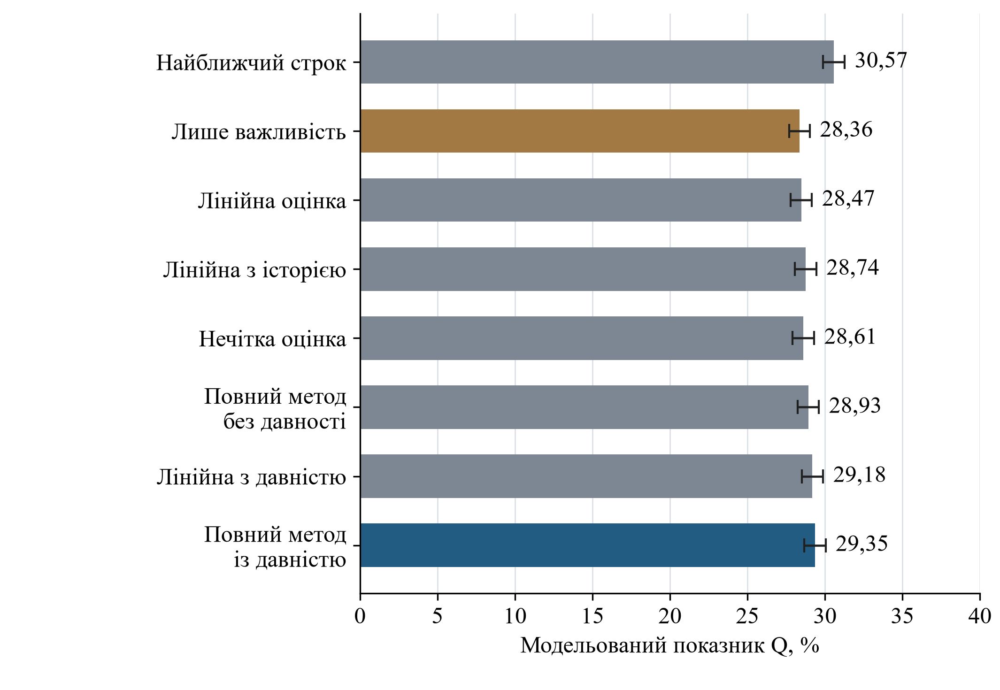

# Модель рекомендацій і відтворення дослідження

## Принцип роботи

Пріоритет задачі визначається нечіткою оцінкою важливості й терміновості.
Оцінка придатності часового інтервалу враховує попередні спроби виконання
для відповідної категорії та частини доби. Вага спостереження зменшується
вдвічі кожні 14 днів. Початкові ваги пріоритету та історії становлять 0,8 і 0,2.
Без історії її оцінка нейтральна – 0,5.

Планування враховує доступні години, зайняті інтервали, тривалість,
найраніший початок і граничний строк. Реалізація міститься в
`app/recommender.py`, підготовка даних і прийняття планів – у
`app/recommendations.py`. Рейтинговий бал не є перевіреною ймовірністю виконання.

## Збережені експерименти

| Набір | Зміст |
|---|---|
| `results_v1` | Початкове порівняння п'яти варіантів моделі |
| `results_v2` | Порівняння з урахуванням давності історії |
| `results_v2_extended` | Вісім варіантів на 1440 сценаріях; 11520 планів |
| `results_supervisor_15` | Набори по 15 задач: 200 наборів із двома умовами історії; 3200 планів |

Назви каталогів та ідентифікатори збережено для сумісності з кодом,
маніфестами й контрольними сумами. Файли `inputs.jsonl` містять синтетичні входи,
`assignments.jsonl` – побудовані плани, `case_metrics.csv` – метрики сценаріїв,
а `analysis/` – агреговані результати. `manifest.json` фіксує параметри
середовища, статус запуску та SHA-256. Час виконання залежить від комп'ютера.

Основні підсумки:

- [Порівняння восьми варіантів](../experiments/results_v2_extended/analysis/summary.csv)
- [Парні зіставлення](../experiments/results_v2_extended/analysis/paired_comparisons.csv)
- [Порівняння на наборах по 15 задач](../experiments/results_supervisor_15/analysis/summary.csv)



Ці результати характеризують заданий синтетичний генератор.
Загальної переваги над усіма базовими способами планування не встановлено.
Протоколи й припущення збережено в `experiments/protocol*.md`.

## Повторний запуск

Команди виконуються з кореня проєкту. Для аналізу й графіків додатково потрібні
NumPy і Matplotlib:

```powershell
.\.venv\Scripts\python.exe -m pip install numpy matplotlib
```

Повторне порівняння восьми варіантів на збережених сценаріях:

```powershell
.\.venv\Scripts\python.exe -m experiments.run_extended_comparison --output experiments/results_repeat_extended --timing-repeats 3
.\.venv\Scripts\python.exe -m experiments.analyze_supervisor_results extension --input experiments/results_repeat_extended --output experiments/results_repeat_extended/analysis
```

Незалежне повторення наборів по 15 задач:

```powershell
.\.venv\Scripts\python.exe -m experiments.run_supervisor_15 --output experiments/results_repeat_15 --repeats 200 --timing-repeats 3
.\.venv\Scripts\python.exe -m experiments.analyze_supervisor_results supervisor --input experiments/results_repeat_15 --output experiments/results_repeat_15/analysis
```

Використовуйте новий каталог для кожного повторення: наявні результати
захищено від перезаписування. Фіксовані випадкові зерна забезпечують однакові
сценарії; виміряний час і точні байти графіків можуть залежати від середовища.
Збережені версії NumPy і Matplotlib зазначено в маніфестах відповідних запусків.

Побудова графіків зі збережених основних результатів:

```powershell
.\.venv\Scripts\python.exe -m experiments.plot_supervisor_results
```

Ця команда записує графіки в `docs/` і оновлює маніфести графіків.
Вона читає основні результати, а не каталоги повторних запусків.
